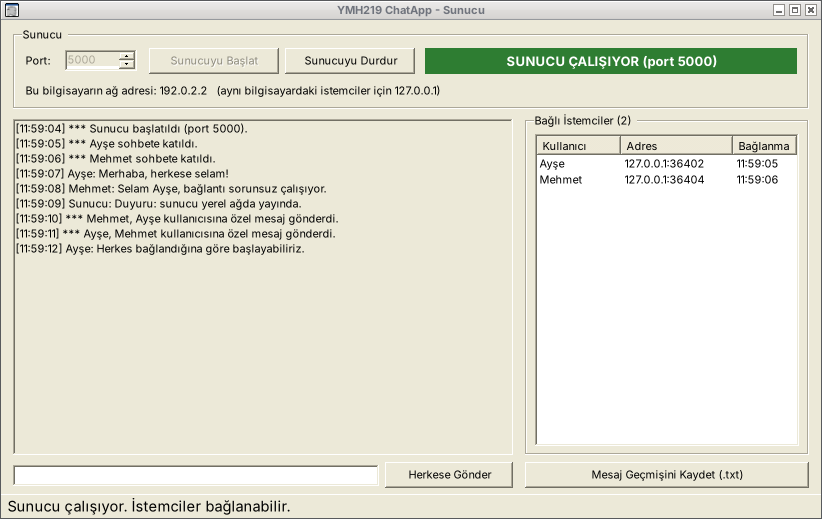
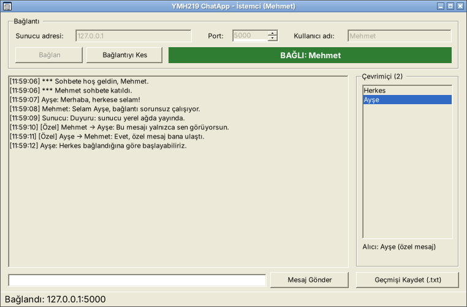

# YMH219-ChatApp

TCP üzerinden çalışan istemci-sunucu sohbet uygulaması. Bir sunucu ve ona kullanıcı adıyla bağlanan bir veya daha fazla istemci, aynı bilgisayarda veya aynı yerel ağda mesajlaşabilir. Mesajlar arayüzde zaman bilgisiyle gösterilir.

Nesne Tabanlı Programlama (YMH 219) dersi ek uygulama ödevidir.

## Kullanılan Teknolojiler

- C# / .NET, Windows Forms
- `TcpListener` ve `TcpClient` ile TCP/IP iletişimi
- `StreamReader` ve `StreamWriter` ile satır tabanlı mesaj aktarımı (UTF-8)
- `async` / `await` ile asenkron ağ işlemleri
- Harici NuGet paketi kullanılmamıştır.

## Kurulum ve Çalıştırma

1. Depoyu klonlayın:
   ```bash
   git clone https://github.com/KULLANICI_ADI/YMH219-ChatApp.git
   ```
2. `YMH219-ChatApp.sln` dosyasını Visual Studio ile açın.
3. **F5** ile çalıştırın.

Gereksinimler: Windows ve Visual Studio (.NET masaüstü geliştirme iş yükü).

## Kullanım

### Aynı bilgisayarda

1. Açılış penceresinde **Sunucu Penceresi Aç** düğmesine basın, ardından **Sunucuyu Başlat** ile sunucuyu çalıştırın (varsayılan port 5000).
2. **İstemci Penceresi Aç** düğmesine basın. Sunucu adresi `127.0.0.1` olarak kalsın, bir kullanıcı adı yazıp **Bağlan** düğmesine basın.
3. İkinci bir kullanıcı için yeni bir istemci penceresi açıp farklı bir adla bağlanın.
4. Mesajı yazıp **Mesaj Gönder** düğmesine veya Enter tuşuna basın.
5. Özel mesaj için sağdaki listeden bir kullanıcı seçin; herkese yazmak için **Herkes** satırını seçin.
6. **Bağlantıyı Kes** ile sohbetten ayrılın.

### Aynı yerel ağdaki farklı bilgisayarlarda

1. Uygulamayı her bilgisayarda çalıştırın.
2. Bir bilgisayarda sunucuyu başlatın. Sunucu penceresinde o bilgisayarın ağ adresi görünür.
3. Diğer bilgisayarlarda istemci penceresini açın, sunucu adresi olarak bu adresi yazıp bağlanın.
4. Windows Güvenlik Duvarı sunucu ilk başlatıldığında izin isterse erişime izin verin.

## Temel Özellikler

- Sunucu ve istemci tek uygulamada, ayrı pencereler olarak çalışır
- İstemci kullanıcı adıyla bağlanır; aynı ad ikinci kez kullanılamaz
- Gönderilen ve alınan mesajlar saat bilgisiyle listelenir
- Bağlan, Mesaj Gönder ve Bağlantıyı Kes işlevleri
- Renkli bağlantı durumu göstergesi (bağlı değil, bağlanıyor, bağlı)
- Sunucuda bağlı istemcilerin kullanıcı adı, adresi ve bağlanma saati listelenir
- Bağlantı hataları (sunucu kapalı, yanlış port, bağlantının kopması, dolu port) uygulama kapanmadan kullanıcıya bildirilir
- Birden fazla istemci aynı sohbete katılabilir; katılma ve ayrılma bildirimleri herkese iletilir
- Özel mesaj: yalnızca seçilen kullanıcıya gider, içeriği sunucu ekranına yazılmaz
- Sunucu da herkese duyuru gönderebilir
- Mesaj geçmişi `.txt` dosyasına kaydedilebilir

## Mesaj Biçimi

Her mesaj ağ üzerinden tek satır olarak gönderilir. Alanlar sekme karakteriyle ayrılır:

```
Tür <TAB> Zaman <TAB> Gönderen <TAB> Alıcı <TAB> Metin
```

Türler: `Join`, `Welcome`, `Error`, `Chat`, `Private`, `Notice`, `Users`.

## Proje Yapısı

| Dosya | Görevi |
|---|---|
| `MainForm.cs` | Açılış penceresi; sunucu ve istemci pencerelerini açar |
| `ServerForm.cs` | Sunucu arayüzü: başlat, durdur, istemci listesi, mesajlar |
| `ClientForm.cs` | İstemci arayüzü: bağlan, mesaj gönder, bağlantıyı kes |
| `ChatServer.cs` | Bağlantıları kabul eder, mesajları istemcilere iletir |
| `ClientSession.cs` | Sunucuya bağlı tek bir istemcinin kaydı |
| `ChatClient.cs` | Sunucuya bağlanır, mesaj gönderir ve alır |
| `ChatConnection.cs` | Tek bir TCP bağlantısı üzerinden mesaj okuma ve yazma |
| `ChatMessage.cs` | Mesaj sınıfı; satıra çevirme ve satırdan okuma |
| `MessageType.cs` | Mesaj türleri |
| `UserNameRules.cs` | Kullanıcı adı kuralları |
| `ChatHistoryWriter.cs` | Mesaj geçmişini dosyaya yazar |

## Ekran Görüntüleri





## Bilinen Sınırlamalar ve Geliştirme Notları

- Mesajlar şifrelenmeden gönderilir; uygulama yalnızca güvenilir yerel ağlar içindir.
- Kullanıcılar için parola veya kimlik doğrulama yoktur.
- Mesaj geçmişi yalnızca pencere açıkken tutulur; kaydedilmezse pencere kapanınca silinir.
- Bir mesaj en fazla 500 karakter olabilir.
- Tek bir sohbet odası vardır.
- Farklı ağlardaki bilgisayarlar arasında (internet üzerinden) bağlantı için yönlendirici ayarı gerekir; bu ödev kapsamında denenmemiştir.

## Öğrenci

Ad Soyad - Öğrenci No
